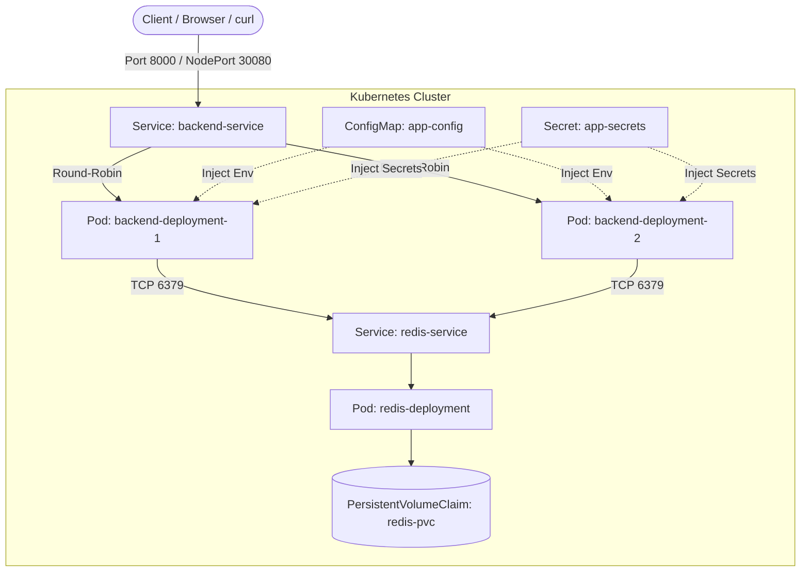

# ☸️ Cloud-Native Kubernetes Microservice (FastAPI + Redis)

[](https://github.com/Himanshu-Sheta/k8s-fastapi-redis/actions)


A production-grade cloud-native demonstration application running on **Kubernetes**, designed to illustrate real-world DevOps practices: **multi-replica deployments, internal service discovery, persistent storage, health probes, rolling updates, and self-healing infrastructure**.

---

## 🏗️ Architecture



---

## 🌟 Key Kubernetes Features Demonstrated

| Concept | Implementation in this project |
| :--- | :--- |
| **High Availability & Replicas** | 2 backend pods managed by `Deployment` with automated load balancing. |
| **Data Persistence** | `PersistentVolumeClaim` ensures Redis cache state survives pod restarts. |
| **Self-Healing Probes** | `livenessProbe` and `readinessProbe` monitor `/health` and auto-restart failed pods. |
| **Zero-Downtime Rollouts** | Configured `RollingUpdate` strategy (`maxSurge: 1`, `maxUnavailable: 0`). |
| **Configuration Decoupling** | App settings injected via `ConfigMap` and sensitive keys via `Secret`. |
| **Auto-Scaling (HPA)** | `HorizontalPodAutoscaler` scales backend pods from 2 to 5 based on CPU load. |
| **Automated CI** | GitHub Actions pipeline lints code, validates Kubernetes YAML, and builds the container. |

---

## 📁 Repository Structure

```text
k8s-fastapi-redis/
├── .github/
│   └── workflows/
│       └── ci.yml               # Automated GitHub Actions CI workflow
├── app/
│   ├── Dockerfile               # Lean, non-root Python container
│   ├── main.py                  # FastAPI application with health checks & Redis
│   └── requirements.txt         # Dependencies
├── k8s/
│   ├── configmap.yaml           # Application configuration
│   ├── secrets.yaml             # Application secrets
│   ├── redis.yaml               # Redis PVC, Deployment, and Service
│   ├── backend.yaml             # FastAPI Deployment (2 replicas) & NodePort Service
│   └── hpa.yaml                 # Horizontal Pod Autoscaler definition
├── .gitignore
└── README.md
```

---

## 🚀 Quickstart Guide

### 1. Prerequisites
- [Docker](https://docs.docker.com/get-docker/)
- [kubectl](https://kubernetes.io/docs/tasks/tools/)
- A local Kubernetes cluster: **Docker Desktop Kubernetes**, **Minikube**, or **Kind**

### 2. Build the Docker Image
```bash
docker build -t k8s-fastapi-demo:latest ./app
```

> **Note for Minikube users**: run `eval $(minikube docker-env)` before building, or run `minikube image load k8s-fastapi-demo:latest`.  
> **Note for Kind users**: run `kind load docker-image k8s-fastapi-demo:latest`.

### 3. Deploy to Kubernetes
Apply all manifests with a single command:
```bash
kubectl apply -f k8s/
```

Verify that all resources are active:
```bash
kubectl get pods
kubectl get services
kubectl get pvc
```

Expected output:
```text
NAME                                  READY   STATUS    RESTARTS   AGE
backend-deployment-xxxxxxxxxx-abcde   1/1     Running   0          30s
backend-deployment-xxxxxxxxxx-fghij   1/1     Running   0          30s
redis-deployment-yyyyyyyyyy-klmno     1/1     Running   0          35s
```

### 4. Access the API
Forward port 8000 to your machine:
```bash
kubectl port-forward service/backend-service 8000:8000
```

Open your browser at [http://localhost:8000](http://localhost:8000) or test with `curl`:
```bash
curl http://localhost:8000/
```

---

## 🧪 Testing Kubernetes Superpowers

### 1. Pod Load Balancing
Run `curl http://localhost:8000/` multiple times:
```json
{
  "status": "online",
  "served_by_pod": "backend-deployment-64d8dbf48b-w4n9m",
  "total_hits": 1
}
```
Notice how `served_by_pod` alternates between the two pod instances while `total_hits` increments continuously!

### 2. Testing Self-Healing (Pod Eviction & Recovery)
Simulate a pod failure by killing one of the backend pods:
```bash
kubectl delete pod -l app=backend --now
```
Immediately check pods:
```bash
kubectl get pods
```
Kubernetes instantly spins up a replacement pod to maintain your desired replica count of 2.

### 3. Testing Persistent Storage
Save an item into Redis:
```bash
curl -X POST "http://localhost:8000/items/project?value=kubernetes-fastapi"
```

Now delete the Redis pod:
```bash
kubectl delete pod -l app=redis --now
```

Wait 5 seconds for the new Redis pod to start, then retrieve the item:
```bash
curl "http://localhost:8000/items/project"
```
Output:
```json
{"key": "project", "value": "kubernetes-fastapi"}
```
The data is preserved because of the `PersistentVolumeClaim`!

---

## 🧹 Cleanup

To remove all deployed resources from your cluster:
```bash
kubectl delete -f k8s/
```

---

## 👤 Author
**Himanshu Sheta**
- GitHub: [@Himanshu-Sheta](https://github.com/Himanshu-Sheta)
